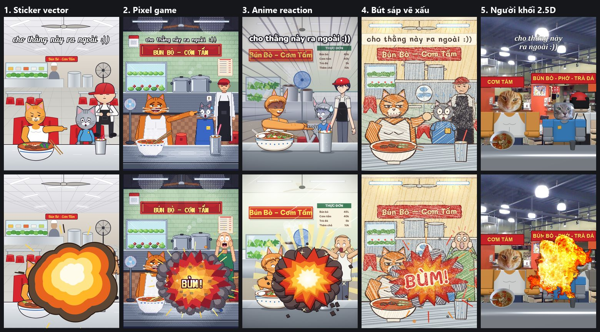
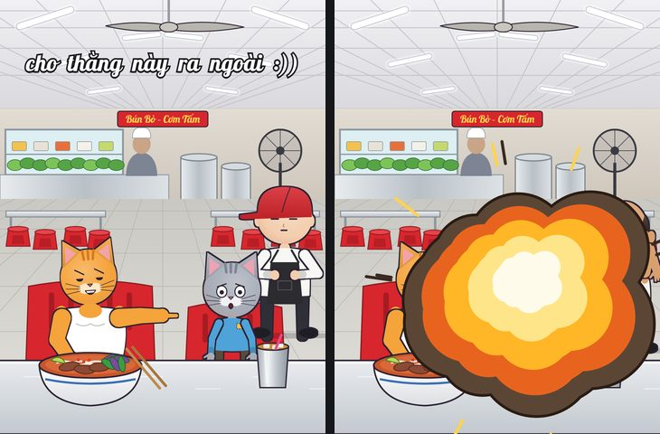
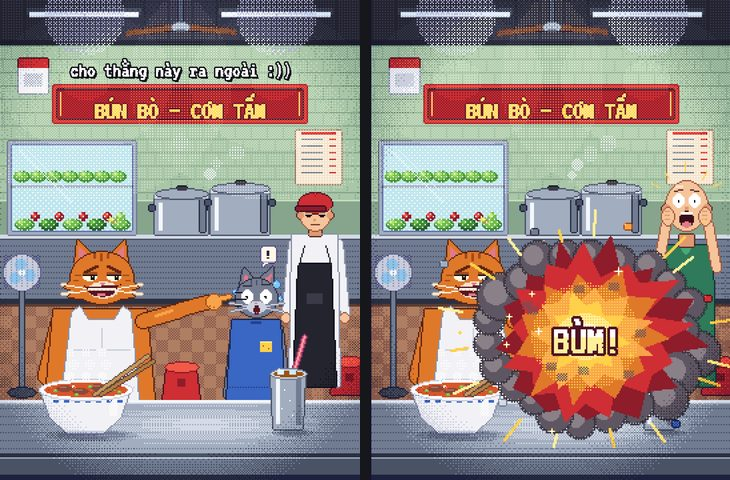
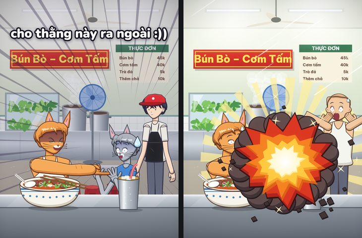
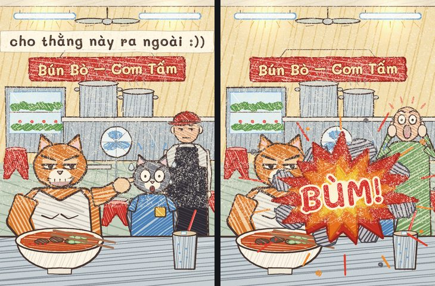
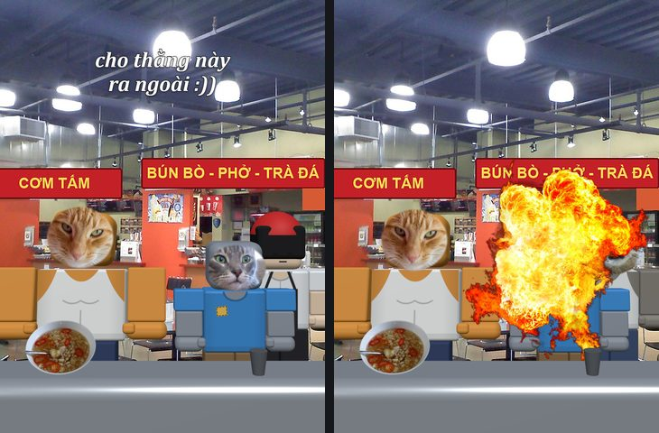

# 🎬 AI Clone Viral Reel Studio

> **Studio sản xuất video viral hoạt họa tự động điều khiển 100% bằng Chat với AI Agent (Antigravity, Claude Code, Codex CLI, Gemini CLI)**.  
> Tái cấu trúc từ ReelMimic — loại bỏ hoàn toàn web server cồng kềnh, chuyển toàn bộ quyền chỉ huy về khung chat của bạn.

---

## ✨ Điểm nổi bật
* **Trực quan & Tương tác cao:** Thảo luận, sửa kịch bản, xem trước storyboard, ảnh nhân vật ngay trong khung chat của Agent.
* **Tự động phân tích video mẫu:** Nhận diện góc máy, tốc độ cắt cảnh, nhịp beat, chuyển động camera từ TikTok, Reels, Shorts.
* **Diễn hoạt bằng Code thuần (Procedural Animation):** Sinh mã Vector SVG, Canvas, HTML5 và HyperFrames mượt mà ở độ phân giải 1080x1920 (9:16).
* **Kiểm định chất lượng gắt gao:** Tự động so sánh khung hình đối chiếu với video mẫu, đạt chuẩn $\ge 4.0/5$ mới xuất file MP4.
* **Tối ưu ổ đĩa:** Bộ nhớ đệm tự động lưu trên ổ E (`projects/.cache`), không làm tràn ổ hệ thống C.

---

## 🎨 Phong cách minh họa

Cùng một kịch bản meme 13 giây ("Có thằng bạn đáng đồng tiền :))": Tèo quên tiền, Bự gọi phục vụ, rồi lật kèo đuổi bạn ra ngoài), dựng bằng 5 phong cách khác nhau. Mỗi ô có 2 khung: **9,5 giây** (lật kèo) và **11,9 giây** (vụ nổ). Tất cả là khung render thật từ engine, nhân vật đều là nhân vật mới, không cắt hình nào từ clip tham khảo.



| Phong cách | Demo | Engine (skill) | Hợp với |
|---|---|---|---|
| **1. Sticker vector**: hoạt hình phẳng nét dày, sticker bật lên kiểu meme editor |  | `hyperframes` + `vector_rig` | Meme đọc rõ, giải thích, comic vlog |
| **2. Pixel game**: pixel art 16-bit, bảng màu giới hạn, chữ và vụ nổ kiểu game |  | `pixel-art` | Nội dung game, Roblox, retro |
| **3. Anime reaction**: cel-shading, giọt mồ hôi, speed lines, impact frame |  | `anime-cel` | Phản ứng kịch tính, slice-of-life |
| **4. Bút sáp vẽ xấu**: nét sáp, chì màu trên giấy, nét rung kiểu trẻ con vẽ |  | `crayon-storybook` | Hài tương phản, kể chuyện nhẹ nhàng |
| **5. Người khối 2.5D**: ảnh chụp làm nền, thân khối kiểu Roblox mặc quần áo, mặt dán ảnh thật |  | `reel25d-meme-video` | Meme cắt dán kiểu "người giả 2.5D" |

Agent tự chọn phong cách theo video mẫu (router đọc `.agents/skills/video-clone/styles/*.md`), hoặc bạn chỉ định thẳng trong chat, ví dụ: *"làm theo phong cách pixel game"*. Ngoài 5 phong cách trên còn có `whiteboard` (bảng trắng vẽ tay), `paper-cutout` (giấy cắt dán stop-motion) và `painted-animation` (màu nước).

<details>
<summary>Nguồn ảnh của demo 2.5D (CC BY 2.0)</summary>

Ảnh nền đã được vẽ đè biển hiệu gốc bằng biển mới. Các ảnh khác được cắt khung oval, tách nền hoặc chỉnh kích thước.

* "Forrestal Village Food Court" by LancerE: https://www.flickr.com/photos/34132829@N07/3964155892
* "Ginger cat" by stecman: https://www.flickr.com/photos/93494757@N08/8638884206
* "Connie Kitty Stare PAD May 6" by AlishaV: https://www.flickr.com/photos/31169339@N07/4585905220
* "Cat or Alien?" by kaibara87: https://www.flickr.com/photos/34745138@N00/2601999508
* "Explosion" by Freidwall: https://www.flickr.com/photos/29105521@N02/7999746744
* "'Phở Cuốn - rolled Pho' restaurant in Hue 02t.JPG" by midorisyu: https://www.flickr.com/photos/9802162@N03/2896973599

Giấy phép: https://creativecommons.org/licenses/by/2.0/. Font caption của demo sticker vector là Lobster (SIL OFL 1.1).
</details>

---

## 🚀 Cài đặt nhanh

### 1. Yêu cầu hệ thống
* **Node.js** $\ge$ 20.0 (Đã có sẵn v22)
* **Python** $\ge$ 3.10 (Đã có sẵn 3.11)
* **FFmpeg & ffprobe** (Đã có trên PATH)
* **Google Chrome** (Dùng để render khung hình không giao diện)

### 2. Cài đặt thư viện
```bash
npm install                        # cài HyperFrames + tự tạo liên kết .claude/skills → .agents/skills
pip install -r requirements.txt    # thư viện Python (phân tích video, chấm điểm, pytest)
```

### 3. Kiểm tra môi trường
Chỉ cần chạy lệnh kiểm tra:
```bash
npm run doctor
```
*(Tất cả tích xanh `✓` là sẵn sàng).*

---

## 🤖 Dùng được với nhiều AI Agent

Toàn bộ skill nằm ở **một chỗ duy nhất: `.agents/skills/`** (chuẩn Agent Skills chung), nên mọi agent đều dùng chung một bản:

| Agent | Đọc skill từ | Đọc hướng dẫn dự án từ |
|---|---|---|
| **Codex CLI** | `.agents/skills/` (mặc định) | `AGENTS.md` |
| **Gemini CLI** | `.agents/skills/` (mặc định) | `AGENTS.md` (cấu hình trong `.gemini/settings.json`) |
| **Claude Code** | `.claude/skills/` → liên kết tới `.agents/skills/` | `CLAUDE.md` + `AGENTS.md` |
| **Antigravity** | `.agents/skills/` | `AGENTS.md` |

* `.claude/skills` là **liên kết (junction)**, không có trong git. Clone repo xong chạy `npm install` hoặc `npm run link-skills` một lần để tạo. Nếu công cụ nào không đọc được liên kết: `npm run link-skills -- --copy` (tạo bản sao, nhớ chạy lại sau khi sửa skill).
* Gemini CLI chỉ nạp skill khi thư mục dự án được đánh dấu **trusted**.
* Thêm hoặc sửa skill: luôn làm trong `.agents/skills/`, không sửa trong `.claude/skills/`.

---

## 💬 Cách sử dụng trong Chat (Antigravity / Claude Code / Codex / Gemini CLI)

Bạn chỉ cần mở dự án này trong agent bạn thích và ra lệnh bằng ngôn ngữ tự nhiên:

### Ví dụ 1: Bắt đầu clone một video
> *"Hãy phân tích video này giúp tôi: `https://www.tiktok.com/@user/video/1234567890`. Tôi muốn làm một video dạng hoạt họa giải thích về cách quản lý chi tiêu cá nhân."*

Agent sẽ:
1. Tải và phân tích nhịp dựng, góc máy của video mẫu.
2. Lên Storyboard chi tiết từng cảnh và gửi bạn xem trước trong Chat.

### Ví dụ 2: Góp ý và chỉnh sửa kịch bản
> *"Kịch bản hay đấy, nhưng ở cảnh 2 hãy đổi màu nhân vật thành màu xanh dương và lời thoại đổi thành tiếng Việt nhé."*

Agent sẽ sửa lại ngay lập tức và render ảnh phác thảo nhân vật để bạn duyệt.

### Ví dụ 3: Duyệt và render
> *"OK duyệt phương án này, render video cho tôi."*

Agent sẽ lập trình hoạt họa, gọi Chrome render ngầm, chạy kiểm định chất lượng và xuất ra file hoàn chỉnh tại `projects/<tên-dự-án>/out/video.mp4`.

---

## 📂 Cấu trúc thư mục

```
ai-clone-viral-reel/
├── .agents/skills/        # 37 Skills & Animation Engines (HyperFrames, Anime, Crayon, Pixel, 2.5D reel25d...) — bản gốc duy nhất
├── .claude/skills         # Liên kết tới .agents/skills cho Claude Code (tạo bằng npm run link-skills)
├── .gemini/settings.json  # Cho Gemini CLI đọc AGENTS.md
├── docs/                  # Tài liệu kiến trúc chuyên sâu (ảnh demo phong cách: docs/assets/styles/)
├── projects/              # Nơi chứa các dự án video bạn tạo
├── scripts/
│   ├── doctor.mjs         # Kiểm tra môi trường máy
│   └── link-skills.mjs    # Tạo liên kết .claude/skills → .agents/skills
├── AGENTS.md              # Hướng dẫn quy trình dành riêng cho AI Director (Codex, Gemini, Antigravity)
├── CLAUDE.md              # Hướng dẫn kiến trúc & lệnh cho Claude Code
├── requirements.txt       # Các thư viện Python
├── package.json           # Cấu hình dự án
└── secrets.example.json   # Mẫu cấu hình API key tùy chọn (TTS, Freesound...)
```
